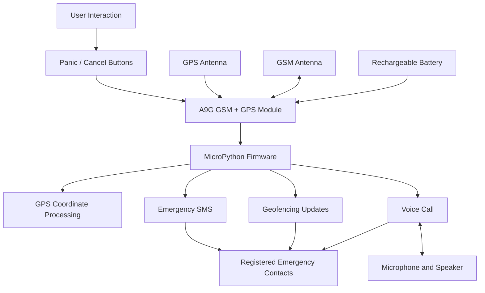
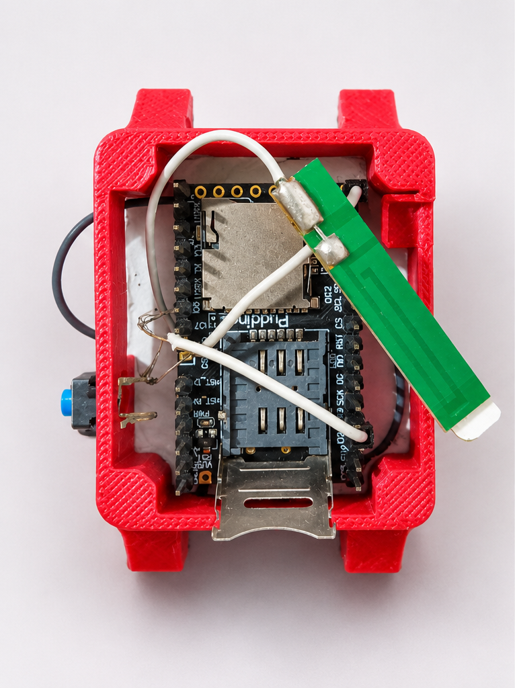
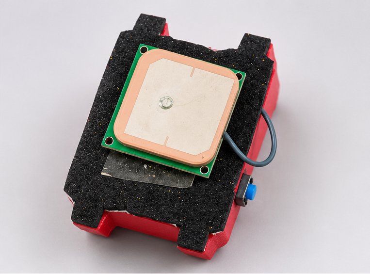
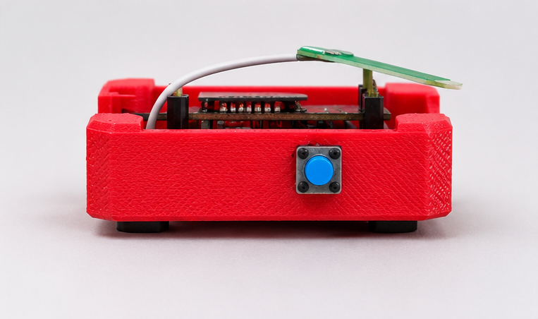

# EVA – Empowered Vigilant Assistant

### A Smart Wearable Personal Safety Bracelet with GPS Tracking, GSM Emergency Alerts and Two-Way Voice Communication

  <strong>Personal Safety | Real-Time Location Tracking | Emergency Communication</strong>

---

## 📌 Project Overview

**EVA (Empowered Vigilant Assistant)** is a smart wearable personal safety bracelet designed to provide immediate assistance during emergency situations. The system integrates GPS-based real-time location tracking, GSM communication, emergency alert activation, geofencing-based location updates, and two-way voice communication into a compact wearable device.

The primary objective of EVA is to enable users to alert their pre-registered emergency contacts and share their current location without needing to access a smartphone.

Built around the **AI Thinker A9G GSM + GPS module**, the bracelet operates as a standalone device using cellular communication for emergency SMS alerts and voice calls.

## 🎯 Objectives

- Develop a compact and wearable personal safety device.
- Enable emergency alert activation through a physical panic button.
- Retrieve GPS coordinates and share the user's location with registered contacts.
- Automatically initiate emergency voice calls.
- Provide a mechanism to cancel false emergency alerts.
- Implement geofencing-based periodic location tracking.
- Enable two-way voice communication through the bracelet.
- Minimize dependence on smartphones and internet-based applications.

## ✨ Key Features

### 1. Emergency Alert Activation
A physical panic button allows the user to activate the emergency response mechanism. The system retrieves GPS coordinates, sends an emergency SMS to pre-registered contacts, and initiates a voice call.

### 2. Real-Time GPS Location Tracking
The A9G module acquires GPS coordinates, processes NMEA data, and includes the user's latitude and longitude in emergency messages.

### 3. False Alert Cancellation
A cancellation mechanism allows the user to stop an accidentally triggered emergency alert using the configured button-press logic.

### 4. Geofencing and Continuous Location Updates
A long button press activates the geofencing-based monitoring mode. The device sends periodic GPS location updates to registered contacts at **3-minute intervals**.

### 5. Automatic Voice Calling
Following emergency SMS transmission, the system automatically initiates a call to a pre-registered emergency contact.

### 6. Two-Way Voice Communication
An integrated microphone and speaker allow the user to communicate directly with the emergency contact through the bracelet.

### 7. Standalone Operation
EVA does not require a smartphone or companion application. It uses GPS for positioning and GSM cellular connectivity for emergency communication.

---

## 🏗️ System Architecture

The A9G GSM + GPS development board acts as the central processing and communication unit. It handles GPS acquisition, firmware execution, button inputs, SMS transmission, and voice call initiation.

---

## 🔩 Hardware Requirements

| Component | Purpose |
|---|---|
| AI Thinker A9G GSM + GPS Development Board | Main processing, GPS tracking and GSM communication |
| GPS Patch Antenna | Receives satellite signals |
| GSM Antenna | Enables cellular communication |
| Panic Button | Activates emergency response |
| Cancel Button | Cancels false emergency alerts |
| Rechargeable Li-Po Battery | Portable power supply |
| Microphone | Captures the user's voice |
| Speaker | Enables voice communication |
| FTDI USB-to-Serial Converter | Firmware uploading and debugging |
| 3D-Printed Enclosure | Houses and protects the hardware |

### A9G Module Specifications

| Parameter | Specification |
|---|---|
| GSM Frequency Bands | 850 / 900 / 1800 / 1900 MHz |
| GPS Sensitivity | -148 dBm (acquisition), -162 dBm (tracking) |
| GPS Accuracy | ≤ 2.5 m CEP (open sky, module specification) |
| Operating Voltage | 3.3 V – 4.2 V |
| Communication Interface | UART |
| Communication Control | AT Commands |
| Programming Language | MicroPython |
| Module Dimensions | 19 mm × 19 mm |
| Operating Temperature | -40°C to +85°C |

---

## 💻 Software Requirements

| Technology | Purpose |
|---|---|
| MicroPython | Embedded firmware development |
| Thonny IDE | Writing, uploading and debugging firmware |
| UART | Serial communication |
| AT Commands | GSM SMS and voice call control |
| NMEA Protocol | GPS data processing |

---

## ⚙️ Working Principle

1. The device powers on using its rechargeable battery.
2. The A9G module initializes GPS and GSM functionality.
3. The firmware monitors the button inputs.
4. When an emergency action is triggered, the device retrieves GPS coordinates.
5. The coordinates are included in an emergency SMS.
6. The GSM module sends the alert to pre-registered contacts.
7. An emergency voice call is initiated.
8. If geofencing mode is activated, the device continues sending location updates at configured intervals.

---
## 📸 Project Gallery

### 1. Internal Hardware

### 2. GPS Antenna

### 3. Side View – Emergency Button

## 🧪 Performance Evaluation

| Parameter | Observed Result |
|---|---|
| SMS Delivery Time | 4–6 seconds |
| Voice Call Setup Time | 2–3 seconds |
| GPS Fix Acquisition | 30–60 seconds (cold start) |
| GPS Accuracy | Approximately ±5 metres (outdoor) |
| Geofencing Update Interval | 3 minutes |
| Battery Backup | 8–10 hours |

### Functional Testing Results

| Feature | Result |
|---|---|
| Emergency SMS Alert | Pass |
| GPS Location Retrieval | Pass |
| GSM Voice Call Establishment | Pass |
| Two-Way Voice Communication | Pass |
| False Alert Cancellation | Pass |
| Geofencing / Periodic Updates | Pass |
| Bracelet Enclosure and Wearability | Pass |

---

## 🔋 Power Management

The bracelet uses a rechargeable lithium-polymer battery and achieved approximately 8–10 hours of operation under the reported test conditions.

GPS activation is managed around location acquisition requirements. Further optimization through dedicated low-power modes is identified as a future improvement.

---

## ⚠️ Limitations

- GPS positioning may be unreliable in indoor environments.
- Emergency communication depends on cellular network availability.
- Battery backup is limited to approximately 8–10 hours under tested conditions.
- Emergency contacts currently require firmware-level configuration.
- A complete network outage retry mechanism is not implemented.
- The prototype requires further miniaturization and enclosure refinement.
- The device has not undergone commercial certification or mass-production validation.
- No companion mobile application or cloud-based monitoring platform is currently included.

**Note:** EVA is an academic prototype and is not a certified replacement for emergency services.

---

## 🔮 Future Enhancements

- Develop a companion mobile application with live location tracking and alert history.
- Integrate cloud-based monitoring and multi-contact management.
- Explore Wi-Fi positioning or Bluetooth beacons for indoor location tracking.
- Integrate health monitoring sensors and fall detection.
- Design a custom PCB to reduce the device size.
- Improve battery life through sleep modes and power optimization.
- Implement automatic alert retry mechanisms during network failures.
- Support emergency messages in multiple languages.
- Improve enclosure durability, comfort, and water resistance.

---

## 💰 Estimated Prototype Cost

| Component | Estimated Cost (INR) |
|---|---:|
| A9G Development Board | ₹900–₹1,500 |
| Antennas and Buttons | ₹300–₹600 |
| Rechargeable Battery | ₹400–₹800 |
| FTDI USB-to-Serial Converter | ₹300–₹600 |
| 3D-Printed Enclosure and Miscellaneous | ₹500–₹1,000 |
| **Total Estimated Cost** | **₹2,500–₹5,000** |

*Estimated prototype costs from the project report.*

---

## 👥 Project Team

- **Adhil T S**
- **Dhia Mary Viju**
- **Risvana Rasheed**
- **Shefin Vahid**

**Department:** Artificial Intelligence and Data Science  
**Institution:** Ilahia College of Engineering and Technology, Muvattupuzha  
**University:** APJ Abdul Kalam Technological University (KTU)  
**Academic Year:** 2025–2026

---

## 📄 Project Documentation

- [Download the Complete EVA Project Report](EVA_Project_Report.pdf)
- [View Source Code](src/eva_main.py)

## © Copyright and Intellectual Property

Copyright © 2026 EVA Project Team. All rights reserved.

EVA – Empowered Vigilant Assistant is associated with
a published patent application involving the project
team and Ilahia College of Engineering and Technology.

The source code, documentation and project materials
are provided for viewing and educational evaluation only.

No permission is granted to copy, modify, reproduce,
redistribute or commercially use these materials
without prior written authorization from the respective
rights holders.
---

  <strong>EVA – Empowered Vigilant Assistant</strong> 
  <em>Technology designed to make personal safety more accessible.</em>

